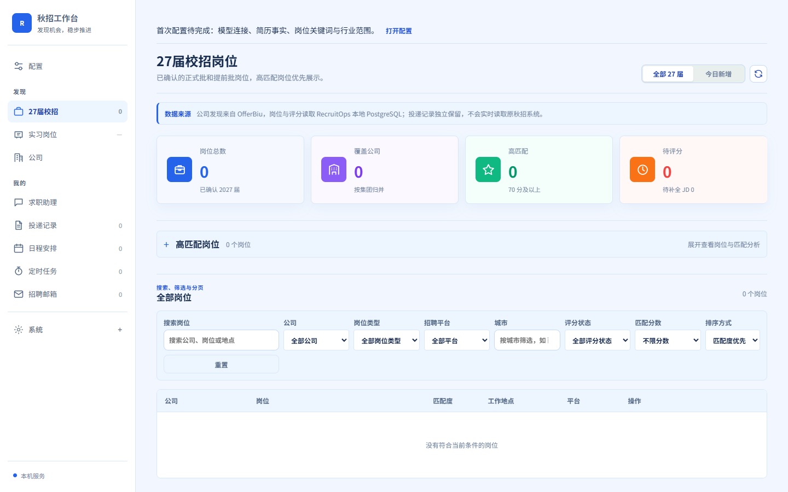
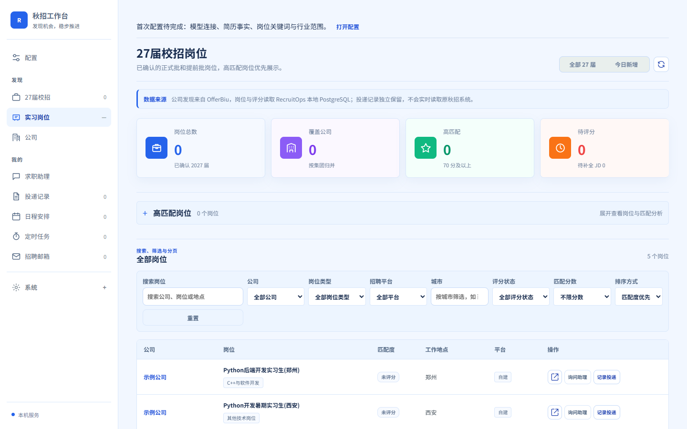
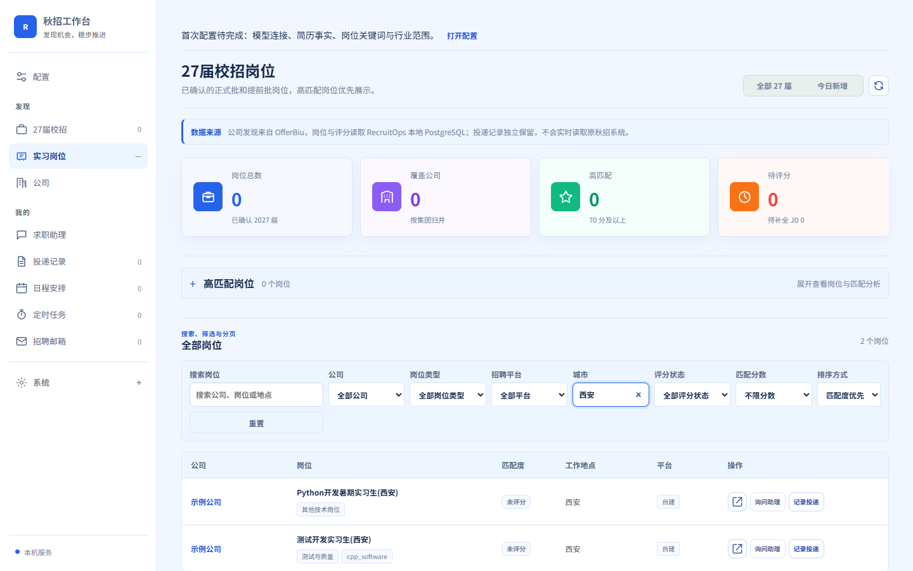
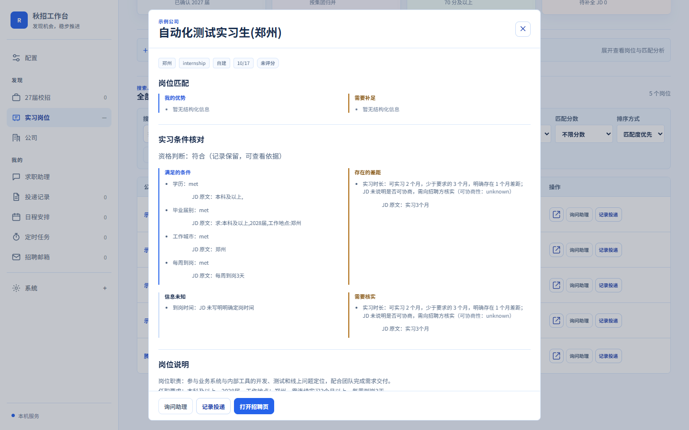
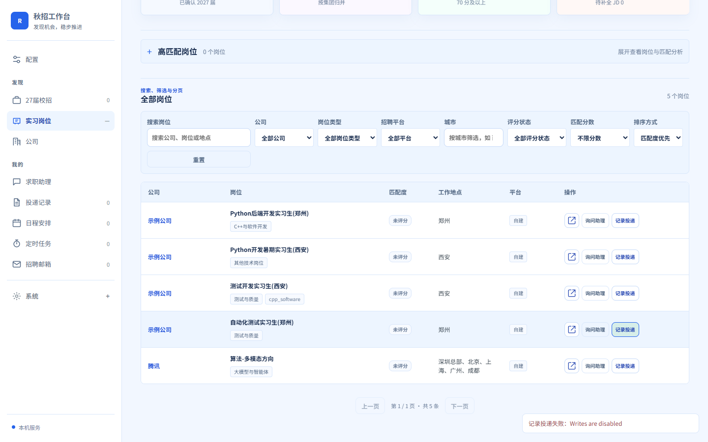

# InternOps — 智能实习岗位发现与匹配系统

在 [RecruitOps](https://github.com/849879772/recruitops-agent) 基础上做的实习方向二次开发（v0.1.0）。
原项目的正式校招流程保持兼容，实习作为**新增轨道**接入同一条采集与分析 Pipeline。

面向实习求职场景：真实岗位采集 → 实习条件结构化解析 → 确定性规则筛选 → LLM 辅助匹配（带 JD 证据校验）
→ 持久化存储 → Web 工作台展示与求职记录。

> **这是二次开发，不是从零实现。** 采集框架、FastAPI 服务、工作台、匹配与存储的主体来自上游项目；
> InternOps 新增的是实习轨道、实习条件模型与筛选策略，以及配套的验证与文档。详见「本次二次开发的范围」。

---

## 技术栈

| 层 | 实际使用 |
|---|---|
| 语言 | Python 3.11 |
| Web 框架 | FastAPI + Uvicorn |
| 存储 | PostgreSQL 16（生产）/ SQLite（开发与测试），SQLAlchemy 2.0 |
| 模型服务 | DeepSeek 官方 API（Anthropic 兼容端点），模型 `deepseek-flash` |
| 前端 | 原生 HTML/CSS/JavaScript（`apps/web`，无框架、无构建步骤） |
| 测试 | pytest、Playwright（驱动本机 Chrome） |

---

## 本次二次开发的范围

**新增**

- `packages/internship/`：实习轨道分类、实习条件抽取、条件评估（met / gap / unknown × 可协商性）。
- `packages/matching/policy.py`：`campus / internship / all` 三档筛选策略，替代原先写死的 2027 届口径。
- 迁移 `027_internship_track.sql`：`track`、`internship_seasons`、`conversion_opportunity`、
  `internship_requirements`、`match_conditions`（JSONB）。
- 腾讯实习采集器 `tencent_intern.py`（公开只读 JSON 接口）。
- LLM 输出的 JD 逐字引用校验（`ground_model_claims`）。
- 工作台「实习岗位」视图、城市筛选、详情页「实习条件核对」四栏。
- 验收脚本与证据：`scripts/verify_internship_pg_pipeline.py`、`scripts/verify_real_llm.py`、
  `scripts/browser_acceptance.py`、`evals/internship_eval.py`。

**未改动（上游原样保留）**

- 校招采集器、`MatchingService` 的评分维度与提示词主体（campus 模式输出保持逐字不变）。
- 工作台整体布局、认证与本地配置机制、许可证。

---

## 主要功能

1. **实习岗位识别与分类** — 依据标题、JD 措辞与批次判定轨道，识别季节（暑期/日常/寒假）与转正机会；
   证据不足时保留 `unknown`，不猜。
2. **实习要求结构化提取** — 从 JD 抽取学历、届别、城市、时长、每周到岗、到岗时间，并记录
   **要求强度**（mandatory / preferred / descriptive / unknown）与**原文片段**。
3. **条件差距与未知区分** — `met` / `gap` / `unknown` 三态；JD 没写就是 `unknown`，绝不当作差距。
4. **可协商性与待核实项** — `negotiability` 只在 JD 有明确措辞时才判定；有差距且可协商性未知时，
   自动标记 `confirmation_required`，提示向招聘方核实。
5. **真实 LLM 辅助分析 + JD 证据校验** — 模型只负责解释与排序；它引用的每条要求必须是 JD 原文片段，
   引用不上的条目会被丢弃，不会进入结果。
6. **岗位筛选与求职记录** — 按城市、公司、平台、评分状态筛选；记录投递阶段（不执行自动投递）。
7. **校招模式兼容** — 默认 `campus` 行为与上游一致；实习岗不会混入校招视图。

---

## 运行

```powershell
# 1. 环境：Python 3.11 + PostgreSQL 16（开发阶段也可只用 SQLite）
python -m pip install -e ".[dev]"

# 2. 配置：复制示例，按需修改
copy config\companies.example.yaml config\companies.yaml
copy config\candidate_profile.example.yaml config\candidate_profile.yaml

# 3. 数据库初始化（PostgreSQL）
python scripts\apply_migrations.py

# 4. 启动后端 + 工作台
uvicorn apps.api.main:app --host 127.0.0.1 --port 8010
# 浏览器打开 http://127.0.0.1:8010/
```

可选环境变量（无需写入文件）：

| 变量 | 作用 |
|---|---|
| `RECRUITOPS_DATABASE_URL` | 指定数据库，默认 SQLite |
| `RECRUITOPS_LLM_API_KEY` | DeepSeek API Key；未设置时不会产生任何模型调用 |

### 采集与验证命令

```powershell
python scripts\collect_tencent_internships.py --limit 60       # 真实采集（联网）
python scripts\seed_internops_demo.py --db %TEMP%\demo.sqlite  # 生成隔离演示库
python scripts\verify_internship_pg_pipeline.py                # PostgreSQL 业务链路（一次性容器）
python scripts\browser_acceptance.py --base-url http://127.0.0.1:8010
python -m evals.internship_eval                                # 离线评测集
.\scripts\run_real_llm_acceptance.ps1                          # 真实模型验收（2 次调用）
```

每条命令都会把带时间戳的 JSON 证据写到 `docs/internops/evidence/`。

---

## 架构与数据流

```
爬虫/适配器  packages/recruitment_core/crawlers/
             ├ tencent.py          正式校招（上游）
             └ tencent_intern.py   实习岗（本次新增）
                        │
                        ▼
Pipeline     packages/pipeline/daily.py
             采集 → 批次审计 → 标题筛 → JD 补全 → 完整门 → 入库 → 评分队列
                        │
                        ▼
筛选策略     packages/matching/policy.py
             ScreeningMode: campus（默认）/ internship / all
                        │
                        ▼
实习领域     packages/internship/
             classification（轨道 / 季节 / 转正）
             requirements（条件 + 强度 + 原文）
             evaluation（met / gap / unknown × 可协商性）
                        │
                        ▼
存储         job_snapshots（迁移 027 新增 5 个字段，JSONB）
                        │
                        ▼
查询/界面    repositories/job_browse.py → apps/api → apps/web 工作台
```

设计约定：**资格（qualification）与保留（retained）分离**——不符合学历门槛的实习岗仍然入库、
可查询、可解释，只是不进入评分；**差距与可协商性正交**——"确实差 1 个月"和"能不能商量"是两个问题。

---

## 界面截图

| 视图 | 截图 |
|---|---|
| 工作台首屏 |  |
| 实习岗位列表 |  |
| 按城市筛选 |  |
| 详情：实习条件核对 |  |
| 记录投递状态 |  |

---

## 验证记录与边界

| 项目 | 结果 | 方式 |
|---|---|---|
| 实习领域测试 | 151 项通过 | pytest（多数无需数据库） |
| 迁移契约 | 通过 | SQLite 集成 |
| PostgreSQL 业务链路 | **14/14** | 一次性 pgvector/pg16 容器，无具名卷 |
| 真实浏览器 | **6/6** | Playwright + 本机 Chrome（`channel="chrome"`） |
| 真实 LLM 调用 | **2/2 成功** | DeepSeek `deepseek-flash`，见 `evidence/task-010-real-llm-*.json` |
| LLM 引用校验 | 记录在案的 8 条引用全部命中 JD 原文 | `tests/test_task010_replay.py` |
| 真实岗位采集 | 腾讯 255 条在招实习，抽样 60 条，入库 11 条 | `evidence/task-005-tencent-*.json` |
| 评测集 | 8/8 | `evals/internship_eval.py` |

**没有验证的部分**（如实记录）：全量 `pytest`（裸跑会包含上游排除的浏览器/桌面运行时用例）、
大规模 LLM 准确率、定时采集、多招聘平台。

---

## 已知限制

1. 真实招聘来源目前只验证了**腾讯**一家；美团契约未复现，华为/字节需要浏览器渲染。
2. 真实 LLM 验收样本只有 **2 条 JD**，只能说明链路可用，**不代表准确率**。
3. 尚未实现定时采集，采集为手动执行。
4. 未达到商业生产环境的高可用/运维标准（无多实例、无限流、无监控告警）。
5. 岗位**内容变更**（同一 id 的 JD 被修改）没有真实案例验证，只验证了重复采集的幂等性。
6. `internship_seasons` / `conversion_opportunity` 目前只支持应用层读取，没有 SQL 过滤与索引。
7. 全量测试套件存在尚未完成的验证边界（上游约 30 个文件需要浏览器或桌面运行时）。

---

## 目录结构（本仓库相关部分）

```
apps/api/              FastAPI 服务
apps/web/              工作台（原生 HTML/CSS/JS）
packages/internship/   实习领域模型（本次新增）
packages/matching/     筛选策略、匹配服务、JD 引用校验
packages/pipeline/     每日采集与分析 Pipeline
packages/storage/      SQLAlchemy 模型与同步
migrations/            001–027（027 为实习轨道）
scripts/               采集、迁移、验收脚本
evals/                 评测集运行器
docs/internops/        本文件与验收证据
tests/                 单元 / 集成 / 回放测试
```

---

## 许可证与署名

上游项目采用 **MIT License**，本仓库保留原有 `LICENSE` 与版权声明。
二次开发部分同样以 MIT 发布，作者与上游的贡献范围在上述「本次二次开发的范围」中明确区分。

`tests/fixtures/tencent_intern_sample.json` 保留了真实接口的响应结构（字段名、状态码、岗位 id），
但**岗位与 JD 正文已全部替换为合成的示例文本**，仓库不再包含任何第三方岗位描述原文。
如需用真实数据回放，请在自己本地运行 `scripts\collect_tencent_internships.py` 重新录制。
公开可访问不等于允许再分发，请勿把采集到的原文提交到公开仓库。
